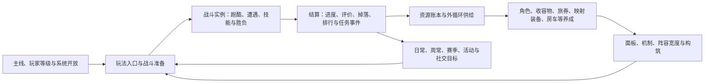

# Vgame 项目级策划知识框架 v0.1（历史候选）

> 当前入口：`knowledge-base/README.md` 与 `knowledge-base/index.html`。  
> 本文件保留 v0.1 的领域、状态与审计结构，用于历史追溯；用户已于 2026-08-17 明确要求改为“项目总览 → 系统 / 战斗 / 数值 → 具体内容与关系”，因此本文件不再是日常知识库首页。  
> 版本：v0.1（历史候选）  
> 日期：2026-08-14  
> 状态：`InReview`  
> 核心裁决：玩家系统一级只分为“战斗内 / 战斗外”；战斗外继续细分玩法、养成、经济等；数值、配置、UI、数据与发布属于覆盖两者的项目支撑层，不是第三类玩家系统。

## 0. 结论与纠偏

上一轮产出的 52 份候选只能称为“文档素材索引”，不能称为项目级策划知识框架，主要原因是：

1. 它按文件逐篇包装，没有先建立战斗内/战斗外领域模型。
2. 它用文件名启发式推断生命周期，误把大量原文明确标记为 `Draft` 的文档归为 `InReview`。
3. 它没有处理“一个玩法同时包含战斗外壳层和战斗内实例规则”的跨域事实。
4. 它没有区分设计是否正式、当前版本是否开放、配置是否存在、规则是否已经落地。

因此，上一轮候选现在只保留为可哈希对照的原文索引；本文件及其领域矩阵才是新的项目级框架入口。

本文件所说的“完整”，是指项目级知识域、边界、闭环、状态轴和证据入口均被纳入；并不表示所有系统规则都已经评审完成或上线。对尚未回源、仍为 Draft、版本关闭或存在冲突的内容，框架保留明确缺口，而不伪造确定性。

## 1. 项目定位

Vgame 当前应被理解为：

> **5 人小队养成驱动的跑酷战斗射击游戏。** 普攻和常规技能自动执行，玩家在跑酷与遭遇节奏中选择必杀释放时机；成长价值最终由不同战斗环境、Boss、长线生存、竞速和阵容广度验证。

项目级核心闭环：



## 2. 玩家系统一级边界：战斗内与战斗外

### 2.1 战斗内系统

边界：从加载战斗实例开始，到胜负成立并触发结算为止。

判断问题：

- 玩家、角色、怪物在战斗中能做什么？
- 技能、Buff、伤害、移动、能量、冷却如何运行？
- 地形、波次、AI、Boss 阶段和模式规则如何制造体验？
- 这一场为什么赢、为什么输、为什么快或慢？

### 2.2 战斗外系统

边界：战斗实例之外，负责组织玩家为何进入、进入什么、用什么阵容、消耗什么、获得什么、如何成长和何时回来。

判断问题：

- 哪个玩法入口开放，挑战条件是什么？
- 玩家如何获得角色、资源、装备和成长材料？
- 日常、周常、赛季、活动、社交和付费如何组织长期目标？
- 战斗结果如何转为进度、奖励、养成和下一次挑战？

### 2.3 横切支撑域

配置、数值、UI、数据、工具、QA、版本和知识治理同时服务战斗内与战斗外。它们属于项目支撑与治理层，不是与“战斗内 / 战斗外”并列的第三类玩家系统，也不应为了满足二分法而被错误塞进某一侧。

### 2.4 关键原则：玩法是跨域对象

不要把“主线、竞技场、爬塔”整块只放在战斗内或战斗外。正确拆法是：

```text
玩法战斗外壳层
  = 入口 + 解锁 + 体力/门票 + 次数 + 编队 + 赛季/排名 + 奖励 + 扫荡

玩法战斗内实例
  = 地形 + 波次 + 敌人 + 模式规则 + 胜负条件 + 战斗时限 + 实时反馈
```

## 3. 项目级知识树

```text
Vgame 项目级策划知识
├─ PF 项目定位与核心闭环
├─ SYS 玩家系统（一级业务分类）
│  ├─ BI 战斗内系统
│  │  ├─ BI-01 战斗规则底座
│  │  ├─ BI-02 角色与队伍战斗
│  │  ├─ BI-03 敌人与 AI
│  │  ├─ BI-04 技能、Buff 与效果
│  │  ├─ BI-05 关卡空间与遭遇
│  │  ├─ BI-06 玩法战斗变体
│  │  ├─ BI-07 战斗数值与难度验证
│  │  ├─ BI-08 战斗引导、UI 与反馈
│  │  └─ BI-09 战斗结果与结算触发
│  └─ BO 战斗外系统
│     ├─ BO-01 玩法与内容编排
│     ├─ BO-02 养成与战力构建
│     ├─ BO-03 获取与阵容扩展
│     ├─ BO-04 资源、经济与奖励
│     ├─ BO-05 任务与留存
│     ├─ BO-06 商业化
│     ├─ BO-07 社交与组织
│     ├─ BO-08 引导、解锁与节奏
│     ├─ BO-09 版本内容、活动与 LiveOps
│     └─ BO-10 战斗外 UI 与信息架构
└─ XS 项目支撑与治理层（非玩家系统分类）
   ├─ XS-01 数值框架与仿真
   ├─ XS-02 配置与数据管线
   ├─ XS-03 内容生产工具
   ├─ XS-04 UI/UX 与表现规范
   ├─ XS-05 数据、埋点与实验
   ├─ XS-06 QA、验收与发布
   ├─ XS-07 知识、证据与生命周期治理
   ├─ XS-08 叙事、文案与本地化
   └─ XS-09 合规、安全与玩家支持
```

## 4. 战斗内知识域

| ID | 子域 | 必须包含的知识 | 当前主要材料 | 向战斗外输出 |
|---|---|---|---|---|
| BI-01 | 战斗规则底座 | 战斗实体、阵营、属性、命中、伤害、暴击、格挡、护盾、治疗、能量、冷却、死亡、胜负 | `伤害计算公式Design Doc`、战斗属性/公式沉淀 | 胜负、伤害统计、资源消耗、成长价值验证 |
| BI-02 | 角色与队伍战斗 | 五人队、职业定位、普攻、自动技能、手动必杀、天赋、被动、协同、目标选择 | 角色/技能/成长文档与角色专项 Skill | DPS、生存、控制、辅助、阵容宽度需求 |
| BI-03 | 敌人与 AI | 普通/精英/Boss、属性模板、阶段、行为树、仇恨、召唤、压制机制 | `怪物与Boss系统Design Doc` | 通关难度、掉落节点、内容复用与版本产能 |
| BI-04 | 技能、Buff 与效果 | SkillLine、ActionClip、事件、打断、Buff 生命周期、叠加、子弹、召唤、伤害效果 | `技能系统Design Doc`、`Buff系统Design Doc` | 角色/敌人机制价值、养成节点和配置需求 |
| BI-05 | 关卡空间与遭遇 | Excel 与 Unity 场景双层、地形、Loop、波次、刷怪点、机关、移动平台、镜头和跑打节奏 | `关卡编辑器Design Doc`、关卡专项 Skill | 关卡完成、事件、节奏数据和内容成本 |
| BI-06 | 玩法战斗变体 | Normal、Coin、Boss、Tower、PVPVE、Mystery 等模式的实时规则与胜负条件 | 各玩法 Design Doc | 玩法结算、排名、最高层、任务事件 |
| BI-07 | 战斗数值与难度验证 | 各玩法的战斗目标、标准场景、难度档、DPS/EHP/TTK/存活时间验收阈值 | 战斗模型、全玩法难度线、战力系统、PVPVE 数值 | 向 XS-01 提出模型需求并消费仿真结果；输出玩法难度评级、养成卡点与验收结论 |
| BI-08 | 战斗引导、UI 与反馈 | BattleGuide、HUD、掉落 Icon、命中/受击反馈、镜头、音效、异常提示 | 新手引导、战斗掉落表现 | 教学完成、可读性、反馈质量与埋点 |
| BI-09 | 战斗结果与结算触发 | 胜负、三星/评价、战利品记录、局内金币、关中/关底掉落、结算事件 | 主线、局内金币、战斗掉落表现 | 进度、任务、奖励、扫荡基线和经济账本 |

### 4.1 战斗内容层级

```text
关卡与地形
└─ 波次与刷怪
   ├─ 怪物 / 精英 / Boss
   │  ├─ 属性
   │  ├─ 技能 / 时间轴 / 伤害 / 子弹 / 召唤
   │  ├─ Buff / 效果
   │  └─ AI / 阶段转换
   ├─ 环境机关与移动平台
   └─ 镜头、特效、音效与战斗事件
```

### 4.2 战斗难度闭环

```text
战斗节点
-> 怪物等级 M
-> 怪物标准模型(M)
-> 玩法生命/攻击/防御系数
-> 实际敌人 EHP 与 DPS
-> 对应同期玩家 DPS / EHP
-> 预测 TTK 与存活时间
-> 实战清关时长、死亡率和技能使用数据校准
```

当前边界：全玩法难度线已有大量怪物等级/系数入口，但多数玩法尚未完整接入同期玩家曲线、预测 TTK 和存活时间；当前玩家战力曲线仍被沉淀标为过渡基线。

### 4.3 当前战斗事实快照

以下事实已经回到当前源码或真实源表核验，用于阻断旧文档口径继续扩散：

| 主题 | 当前回源事实 | 使用规则 |
|---|---|---|
| 护甲公式参数 | `CombatArmorReduceX = 24000` | 不再沿用旧参考中的 2400 |
| Skill Action | 当前 Union 索引 0～72，共 73 类 | 类型白名单以当前源码自动抽取为准 |
| Buff Effect | 当前 Union 索引 0～14，共 15 类 | 类型白名单以当前源码自动抽取为准 |
| Buff 数据 | `Buff.xlsx` 已注册但只存元数据，行为在序列化二进制 | 不能写成“Buff 不在 Excel”，也不能只看 Excel 推断行为 |
| 怪物 AI | 行为树组件、节点、编辑器与运行时资源均存在 | 不再保留“FSM 或行为树待确认”的旧结论；具体怪物到资产覆盖仍需审计 |

完整证据与路径见 `research/combat-domain-audit.md`。

## 5. 战斗外知识域

| ID | 子域 | 核心职责 | 代表系统 | 对战斗的输入 / 从战斗消费的结果 |
|---|---|---|---|---|
| BO-01 | 玩法与内容编排 | 组织主轴、供给、验证玩法的入口、层级、周期、次数、扫荡、排名和结算 | 主线、资源副本、旅券副本、映射装备副本、无限挑战、竞技场、爬塔、大秘境、BOSS挑战 | 输入玩法资格与模式；消费通关、评价、最高层、排名和赛季结果 |
| BO-02 | 养成与战力构建 | 把资源转为角色/账号的属性、机制、构筑和广度 | 角色升级/突破/升星/星盘、收容物、旅券、映射装备、炮台、房车；专武状态待裁决 | 输入属性、技能、套装、队伍宽度；消费战斗掉落和验证结论 |
| BO-03 | 获取与阵容扩展 | 获取角色/收容物、处理重复与碎片、形成 box breadth | 抽卡、新手卡池、碎片回收、招募商店 | 输入可用角色/收容物和机制深度；消费战斗暴露的阵容缺口 |
| BO-04 | 资源、经济与奖励 | 管理物品、货币、来源、消耗、Drop、商店、首通/重复/周期投放 | 金币、元晶、储能、门票、材料、掉落、商店、跑商 | 输入挑战成本和成长资源；消费胜负、掉落、任务和排名结果 |
| BO-05 | 任务与留存 | 将日常、周常、章节、签到、战令和赛季目标组织成回访节奏 | 任务、章节任务、签到、通行证、邮件 | 输入目标和回流动机；消费击杀、通关、成长、活跃和登录事件 |
| BO-06 | 商业化 | 将阵容、资源和时间缺口转为付费选择，同时保护公平和长期价值 | 抽卡、商店、月卡、付费战令、礼包、快捷购买 | 输入成长加速或阵容扩展；消费卡点、资源短缺和长期目标信号 |
| BO-07 | 社交与组织 | 建立关系、协作、比较和组织目标 | 公会、好友、聊天 | 输入组织增益/协作目标；消费战绩、贡献、公会任务和活动结果 |
| BO-08 | 引导、解锁与节奏 | 控制玩家何时看到、理解和使用各系统 | 主角等级、主线、Unlock、SystemOpen、NewbieGuide | 输入入口可见性与教学；消费关卡、等级、任务完成条件 |
| BO-09 | 版本内容、活动与 LiveOps | 编排玩家可见的版本内容、活动、赛季、周期重置、运营奖励和内容日历 | Activity、赛季、主题活动、运营邮件 | 输入当期可玩内容；消费参与、经济、排行和活动结果；技术开关、灰度、Hotfix 与回滚归 XS-06 |
| BO-10 | 战斗外 UI 与信息架构 | 系统入口、页面流程、红点、预览、弹窗、跳转和跨系统导航 | 主界面、玩法入口、养成页、商店、任务、背包 | 输入决策信息；消费系统状态、可领取、缺资源和开放事件 |

### 5.1 养成到战斗的转化

```text
供给玩法 / 外循环 / 抽卡
-> 资源与角色获取
-> 角色本体成长 + 稳定装备成长 + 终局随机成长 + 账号支撑
-> 基础属性 / 百分比 / 二级属性 / 技能机制 / 套装效果 / 阵容宽度
-> 主线、Boss、竞速、爬塔、长线生存、环境适配验证
```

默认职责：

- 角色升级/突破：前中期稳定底盘与等级门槛。
- 星盘/升星：角色差异、天赋和高价值机制节点。
- 收容物：现行新养成与账号/阵容扩展，但 SVN/程序接入状态仍需逐项确认。
- 旅券：中后期稳定装备与套装构筑。
- 映射装备：终局随机深度与长期毕业追求。
- 炮台/基地成长：优先服务 PVPVE，不外推到所有玩法。
- 房车：账号级固定属性、职业树及生产/跑商连接；多项方案已确认但 SVN 状态需分开记录。
- 专武：系统与数值链存在冲突，禁止在裁决前同时按“现行正式”和“已废弃”使用。

### 5.2 经济归属原则

奖励、掉落、概率和产出不单独悬空成为一级业务模块：

```text
具体玩法/系统拥有奖励与消耗规则
-> Item/Drop/Reward 真实引用落账
-> 经济总账跨模块汇总、比较和异常校验
```

所有关卡型玩法至少记录：关卡身份、消耗/次数、首通、重复、概率/权重、周期奖励、UI 预览与真实包差异。

## 6. 正式玩法的双域映射

| 玩法 | 战斗外壳层 | 战斗内实例 | 主要成长/经济职责 | 当前知识状态 |
|---|---|---|---|---|
| 主线 | 章节、节点、前置、三星、奖励、扫荡、系统开放 | 跑酷—遭遇—Boss、教学和标准胜负 | 主进度、早期供给、功能释放、综合账号验证 | 正式项目主轴；Design 为反推 Draft |
| 金币/角色经验资源副本 | 解锁、体力、次数、难度档、结算 | 高频刷取、CoinMode 或效率战斗 | 稳定基础资源供给 | 正式供给玩法；Design 为 Draft |
| 专武经验副本 | 解锁、体力、次数、难度和奖励 | 标准资源副本战斗 | 旧专武经验供给 | 与专武迁移状态一起待裁决 |
| 旅券副本 | 四主题入口、难度、精力、首通/复刷 | 快速进入 Boss、时间限制与阶段机制 | 旅券稳定供给 | 正式；配置差异仍需专项核验 |
| 映射装备副本 | 钥匙、30 层、首通、宝箱/材料、循环 farm | 短循环、高频、清怪效率 | 终局装备、随机深度和材料循环 | 正式；最新数值以专项沉淀为准 |
| 无限挑战 | 开放、最佳深度、周期目标和奖励 | 普通—精英—Boss 循环、难度持续递增 | 长线耐久与账号深度验证 | 正式结构；部分波次/上限口径待统一 |
| 竞技场（PVPVE） | 匹配、门票、段位、赛季、商店、炮台养成 | 同图竞速、杀敌送敌、漏怪打基地、胜负 | 竞争效率、基地生存和赛季留存 | 正式；双方属性对算链未闭环 |
| 爬塔 | 楼层、一次性/周期或挂机口径、解锁、排名 | 每层独立战斗、关键层压力 | 单队纵向强度；新版还连接房车挂机供给 | 正式；奖励版本存在新旧切换 |
| 大秘境 | 28 天赛季、环境、层级、周/赛季结算 | 环境词缀、多 Loop、终局难度 | 阵容广度、环境适配和后期深度 | 设计结构存在；工作副本入口关闭；Production/LIVE=UNKNOWN_LIVE |
| BOSS挑战 | Boss 列表、难度层、一次性奖励 | 独立 Boss 机制和阶段门槛 | Boss 处理能力验证 | 正式 7 Boss×10 层配置证据；汇总链待补 |

## 7. 项目支撑与治理层（非玩家系统分类）

| ID | 子域 | 项目级职责 | 当前成熟度 |
|---|---|---|---|
| XS-01 | 数值框架与仿真 | 维护战斗、养成、经济、节奏四链的共享公式、参数源、生成器、玩家/怪物基线与仿真版本；不替 BI-07 决定具体玩法验收目标 | 已有强框架；玩家终态曲线与部分玩法精算未闭环 |
| XS-02 | 配置与数据管线 | `Datas` 源 Excel → 注册/Schema → TempDatas → Luban → 当前服务端 JSON `Config/GameConfig/server/json` 与客户端生成物 → 校验 | 主链清楚；旧资料中的 `server_json` 路径已漂移，具体系统仍需逐表回源 |
| XS-03 | 内容生产工具 | 关卡编辑器、技能编辑/序列化、GuideEditor 与运行时消费 | 有文档和代码映射；部分表名/消费者待确认 |
| XS-04 | UI/UX 与表现规范 | 战斗内外页面、交互、反馈、预览、红点、弹窗优先级和资产交接 | 局部文档存在；缺项目级 UI 信息架构 |
| XS-05 | 数据、埋点与实验分析 | 指标定义、漏斗、留存、经济监控、战斗数据、实验设计与效果判定；不负责版本部署 | **结构占位：现有 52 份 Design 无主次领域映射，缺权威文档** |
| XS-06 | QA、验收与发布治理 | 规则—配置—实现—UI—验收追踪、自动门禁、功能开关、实验分流部署、灰度、Hotfix、发布与回滚 | 仓库治理较强；缺持续版本级登记 |
| XS-07 | 知识、证据与生命周期治理 | Design→Proposal→Task→配置/代码、权威源、图谱、冲突和归档 | 已有框架；当前文档状态仍需重整 |
| XS-08 | 叙事、文案与本地化 | 世界观、剧情、角色叙事、术语、系统文本与多语言 | **结构占位：现有 52 份 Design 无主次领域映射，缺权威文档** |
| XS-09 | 合规、安全与玩家支持 | 概率公示、付费/未成年人、反作弊、申诉、补偿和客服流程 | **结构占位：现有 52 份 Design 无主次领域映射，缺权威文档** |

## 8. 项目必须维护的四条闭环

### 8.1 玩家短循环

```text
选择玩法 -> 编队/消耗 -> 战斗 -> 胜负/结算 -> 奖励展示 -> 资源入账
```

### 8.2 成长中循环

```text
资源供给 -> 养成选择 -> 属性/机制变化 -> 验证玩法 -> 暴露下一成长目标
```

### 8.3 留存长循环

```text
主线解锁 -> 日/周目标 -> 赛季/活动 -> 阵容与装备深度 -> 终局验证 -> 新版本内容
```

### 8.4 内容生产闭环

```text
Design -> Proposal -> Task
-> Excel/场景/编辑器/代码
-> Luban/序列化/运行时
-> QA/数据验证
-> 版本发布/回滚
-> 事实与文档回写
```

## 9. 状态模型：禁止只用一个“正式”

每个系统至少维护三条状态轴：

| 状态轴 | 推荐枚举 | 回答的问题 |
|---|---|---|
| 设计生命周期 | `DRAFT / IN_REVIEW / APPROVED / TEMPORARY / ARCHIVED / DEPRECATED / REFERENCE / UNKNOWN` | 规则是否已经策划确认？ |
| 运行/发布状态 | `PLAN / DEV / INTERNAL_TEST / GRAY / LIVE / MAINTENANCE / NOT_OPEN / CLOSED / DEPRECATED / REMOVED / UNKNOWN` | 玩家当前是否能用？ |
| 落地证据状态 | `DESIGN_ONLY / CONFIG_MIRROR / DATAS / CLIENT / SERVER / PARTIAL / VERIFIED / MIXED / UNKNOWN` | 规则落到哪一层？ |

另设治理标记 `CLEAR / OPEN / CONFLICT`，只表示是否存在待关闭问题，不属于三条状态轴。`ConfigReady` 应规范化为设计已确认与 `CONFIG_MIRROR` 等落地证据的组合；`CONFLICT` 不能冒充设计生命周期或运行状态。

示例：

- 大秘境：设计结构存在；工作副本 `CloseSys=true`；缺发布台账，不能简写为“正式未开放”或“正式上线”。
- 通行证：正式外循环概念；当前版本可能关闭/封存；Design Doc 仍为 Draft。
- 公会：系统正式；当前经济/实现被标为临时并将大改；部分新规则只到设计或镜像。
- 收容物：原文声明 `ConfigReady`；机器登记为设计 `APPROVED`、落地 `CONFIG_MIRROR`、运行 `UNKNOWN`。
- 专武：核心项目口径与较新抽卡/养成沉淀冲突；设计与运行均保持 `UNKNOWN`，治理标记为 `CONFLICT`。
- 宝石与铭文：文档 Archived；铭文系统当前废弃，不得因文件仍在而恢复。

## 10. 当前项目级冲突与缺口

### P0：会直接污染全项目判断

1. **专武—收容物迁移未形成单一裁决。** 抽卡、资源副本、成长、票券、商店、任务和术语可能跨版本混用。
2. **功能状态没有单一真实注册表。** `SystemOpen`、服务器开关、活动时间、客户端版本门控和发布记录没有汇聚，无法仅凭配置存在判断 LIVE。
3. **玩家战力终态基线未闭环。** 当前沉淀明确仍含废弃专武、未完整接入收容物；全玩法难度不能宣称与最新养成完全对齐。
4. **战斗事实存在旧口径漂移。** 护甲常量、Skill Action、Buff Effect、Buff Excel 和 AI 说明均与当前源码/源表不一致，必须建立自动事实快照。

### P1：知识体系不完整

1. 好友/聊天缺正式策划 Design Doc。
2. 活动/LiveOps 缺当前活动目录、内容日历和经济映射。
3. UI 信息架构、红点体系和跨系统跳转缺项目级总文档。
4. 数据、埋点、AB、灰度、经济监控和战斗指标缺统一设计。
5. 叙事、文案、本地化没有进入现有 52 份 Design 文档的项目级结构。
6. 合规、概率公示、反作弊、客服和补偿治理缺长期文档。

### P2：资料治理问题

1. 多数 Design Doc 原文明确为 `Draft`，但系统本身可能已经存在；需要逐篇区分“反推文档状态”和“系统运行状态”。
2. 映射装备、房车等存在多份日期文档，需要清晰的 supersedes/replaced-by 链。
3. 当前仓库图谱 `.understand-anything/knowledge-graph.json` 于 2026-08-14 生成，负责本次 52/52 文档映射；旧跨仓快照 `knowledge-graph/.understand-anything/knowledge-graph.json` 停在 2026-06-23。两者都只用于导航，旧图尤其不能证明最新配置，领域关系仍须用项目沉淀和真实源表补证。
4. 配置输出路径资料存在漂移：当前真实脚本使用 `Config/GameConfig/server/json`，旧 `server_json` 只能视作历史口径。

## 11. 建议的 Design 目标目录

以下只是目标信息架构，本轮不移动现有文件：

```text
design/
├─ 00-project/
│  ├─ 项目定位与核心循环.md
│  ├─ 项目级策划知识框架.md
│  ├─ 系统状态注册表.md
│  └─ 术语与证据规则.md
├─ 10-combat/
│  ├─ foundation/        # 属性、公式、战力、胜负
│  ├─ character/         # 角色战斗套件
│  ├─ enemy-ai/          # 怪物、Boss、AI
│  ├─ skill-buff/        # 技能、Buff、效果
│  ├─ level-encounter/   # 地形、波次、关卡节奏
│  ├─ modes/             # 各玩法战斗实例规则
│  └─ feedback-guide/    # HUD、反馈、战斗教学
├─ 20-outer-loop/
│  ├─ gameplay/          # 玩法入口、周期、结算壳层
│  ├─ progression/       # 角色、收容物、装备、房车
│  ├─ acquisition/       # 抽卡、碎片、box
│  ├─ economy/           # Item/Drop/商店/资源账本
│  ├─ retention/         # 任务、签到、战令、邮件
│  ├─ monetization/      # 月卡、付费、礼包
│  ├─ social/            # 公会、好友、聊天
│  ├─ onboarding/        # Unlock、SystemOpen、新手
│  └─ liveops/           # 活动、赛季、版本
├─ 30-cross-cutting/
│  ├─ numerical/
│  ├─ config-pipeline/
│  ├─ ui-ux/
│  ├─ analytics/
│  ├─ qa-release/
│  ├─ narrative-localization/
│  └─ compliance-support/
└─ archive/
```

## 12. 使用规则

以后新增或审查一个系统时，必须回答：

1. 它的战斗外壳层是什么？
2. 它是否包含战斗内实例规则？
3. 它消费哪些资源，产出哪些资源，周期和次数是什么？
4. 它改变哪些成长输出，最终由哪些玩法验证？
5. 它依赖哪些入口、Unlock、SystemOpen、配置和编辑器？
6. 它的设计、运行、落地证据分别是什么状态？
7. 正常、失败、断线、过期、重置、补领和回滚如何处理？
8. UI、埋点、QA、版本与知识回写是否闭环？

## 13. 配套索引

- 52 份 Design 文档全量映射：`03-design-document-domain-matrix.md`
- 机器可读领域模型：`project-planning-framework.json`
- Understand 领域图：`.understand-anything/domain-graph.json`
- 战斗内专项审查：`research/combat-domain-audit.md`
- 战斗外专项审查：`research/outer-domain-audit.md`
- 独立一致性审查：`research/independent-consistency-review.md`
- 自动验证：`07-validation-report.json`
- 跨域闭环与责任矩阵：`04-cross-domain-loops.md`
- 状态冲突与事实漂移登记：`05-status-conflict-register.md`
- 独立评审与交付边界：`06-review.md`
- 项目级验收用例：`08-acceptance-cases.md`

本框架当前是项目级候选，不覆盖 `design/`。P0 状态冲突关闭并经用户评审后，才能作为正式项目入口。
