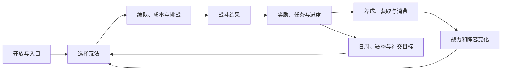

# 12 战斗外系统

## 1. 分类总览

```text
战斗外系统
├─ 玩法：玩家挑战什么
├─ 养成：玩家如何变强和形成构筑
└─ 周边系统：玩家如何获得、消费、回访、社交和参与运营内容
```

## 2. 玩法

### 2.1 主轴与供给玩法

| ID | 系统 | 系统内容 | 主要关系 | 当前安全口径 |
|---|---|---|---|---|
| SYS-OUT-GP-01 | [主线](systems/SYS-OUT-GP-01-主线.md) | 章节、关卡节点、前置、评价、首通、扫荡、剧情与系统开放主轴；已归并完整系统正文 | 解锁其他系统；输出玩家等级、资源和进度 | 当前项目主轴；目标、源表与冲突分层展示 |
| SYS-OUT-GP-02 | 高难主线 | 主线的高难验证与一次性/章节奖励层 | 消费主线进度与成长；反馈高难卡点 | 结构与新奖励方案存在，落地状态另查 |
| SYS-OUT-GP-03 | 金币/角色经验资源副本 | 按开放、体力、次数和难度档提供稳定基础资源 | 供给角色养成与经济循环 | 正式供给结构 |
| SYS-OUT-GP-04 | 旅券副本 | 四类主题 Boss 式关卡，提供旅券相关稳定供给 | 供给旅券养成；验证中期 Boss 处理 | 正式供给结构 |
| SYS-OUT-GP-05 | 映射装备副本 | 高频、短循环、多层刷取和装备/材料掉落 | 供给映射装备长期随机成长 | 正式供给结构 |

### 2.2 挑战与验证玩法

| ID | 系统 | 系统内容 | 主要验证 | 当前安全口径 |
|---|---|---|---|---|
| SYS-OUT-GP-06 | 无限挑战 | 普通—精英—Boss 循环，难度持续递增，记录最佳深度与周期目标 | 长线耐久和账号综合深度 | 正式结构，部分波次口径待统一 |
| SYS-OUT-GP-07 | 竞技场（PVPVE） | 匹配、门票、段位、赛季、商店；局内同图竞速并向对手施压 | 竞速、基地生存和赛季竞争 | 正式结构，双方属性对算链待闭环 |
| SYS-OUT-GP-08 | 爬塔 | 楼层推进、一次性奖励及当前版本的挂机/房车连接 | 单队纵向强度和长期进度 | 正式结构，需区分新旧奖励口径 |
| SYS-OUT-GP-09 | 大秘境 | 赛季、多环境、多层级和排行/结算 | 阵容广度、环境适配和终局深度 | 设计结构存在；工作副本入口关闭；Production/LIVE=UNKNOWN_LIVE |
| SYS-OUT-GP-10 | BOSS 挑战 | Boss 列表、难度层、一次性挑战和专项奖励 | Boss 机制处理与阶段门槛 | 正式结构；目标层数与旧配置需分开 |

### 2.3 玩法便利与衍生

| ID | 系统 | 内容 | 关系 |
|---|---|---|---|
| SYS-OUT-GP-11 | 扫荡 | 对满足条件的已通关内容进行快速结算 | 依赖通关/评价；消费体力或次数；复用真实奖励 |
| SYS-OUT-GP-12 | 跑商 | 商品、地点、事件和货币循环的经营玩法候选 | 连接房车、商店和经济；是否纳入正式结构待确认 |

## 3. 养成

| ID | 系统 | 系统内容 | 战斗输出 | 主要供给/验证 |
|---|---|---|---|---|
| SYS-OUT-GR-01 | 玩家等级 | 账号经验、体力、系统开放和整体进度锚点 | 间接决定可用系统与队伍位 | 主线/任务供给；开放节奏验证 |
| SYS-OUT-GR-02 | 角色升级与突破 | 等级、经验、突破门槛和基础属性成长 | 稳定基础属性底盘 | 角色经验/金币资源；主线验证 |
| SYS-OUT-GR-03 | 角色升星 | 重复角色/碎片转为属性与高价值节点 | 基础属性百分比、天赋或机制增强 | 抽卡/碎片供给；角色强度验证 |
| SYS-OUT-GR-04 | 角色星盘/能效 | 分支节点、二级属性偏向和技能/天赋节点 | 角色差异与构筑方向 | 专项材料；多玩法验证 |
| SYS-OUT-GR-05 | 收容物 | 现行角色配套/阵容扩展养成，包含等级、品质、升星与属性 | 属性、机制与阵容广度 | 抽卡/材料供给；落地仍需逐层核实 |
| SYS-OUT-GR-06 | 旅券 | 装备属性、套装或构筑成长 | 中后期稳定属性与套装效果 | 旅券副本供给；Boss/挑战玩法验证 |
| SYS-OUT-GR-07 | 映射装备 | 品质、部位、主副属性、词条、宝石、制作/合成与长期毕业 | 终局随机深度和差异化属性 | 映射副本供给；终局玩法验证 |
| SYS-OUT-GR-08 | 炮台/基地 | 竞技场基地生命、受怪压力与相关成长 | 主要影响 PVPVE 基地承伤 | 竞技场供给与验证，不外推所有玩法 |
| SYS-OUT-GR-09 | 房车 | 账号属性、职业树、设备、生产与经营连接 | 账号级属性和职业倾向 | 多玩法供给/验证；部分规则只到镜像 |
| SYS-OUT-GR-10 | 专武 | 旧角色专属装备、等级和机制链 | 历史角色成长输出 | 与收容物迁移冲突，不能直接视为现行 |

## 4. 周边系统

### 4.1 获取与阵容

| 系统 | 内容 | 主要连接 |
|---|---|---|
| 角色/新手卡池 | 角色获取、概率、保底和新手定向 | 角色养成、阵容构筑、商业化 |
| 收容物抽卡 | 收容物获取、重复整件转碎片和后续养成入口 | 收容物养成、商店与资源经济 |
| 碎片回收/招募商店 | 重复资源转化、碎片回收和兑换 | 抽卡、角色/收容物获取、货币消耗 |

### 4.2 资源与经济

| 系统 | 内容 | 主要连接 |
|---|---|---|
| 物品与货币 | 金币、元晶、储能、门票、材料和专属货币的身份与用途 | 所有玩法、养成、商店和任务 |
| 掉落与奖励 | 首通、重复、概率、排行、赛季和活动奖励的真实入账 | 战斗结果、UI 预览、经济总账 |
| 商店 | 页签、商品、货币、刷新、限购和快捷购买 | 资源消耗、养成补给、商业化 |
| 体力与次数 | 自然恢复、购买、挑战成本、次数和重置 | 玩法节奏、商店和留存 |

### 4.3 任务与留存

| 系统 | 内容 | 主要连接 |
|---|---|---|
| 每日/每周任务 | 行为目标、活跃度和周期奖励 | 玩法、养成、登录和经济 |
| 章节任务 | 随主线章节组织目标和奖励 | 主线、解锁、资源投放 |
| 签到 | 常规循环、新手七日和累计签到 | 登录留存、资源投放、活动 |
| 邮件 | 系统通知、运营奖励、补偿和过期处理 | LiveOps、异常恢复、经济入账 |
| 通行证 | 赛季经验、免费/付费奖励线和等级目标 | 任务、商业化、赛季；当前记录为不开/封存 |

### 4.4 社交、引导与运营

| 系统 | 内容 | 主要连接 |
|---|---|---|
| 公会 | 成员、任务贡献、派遣、商店、科技和补给 | 社交、任务、养成、经济；当前为临时/待大改口径 |
| 好友/聊天 | 关系、沟通、邀请和社交触点 | 组队/活动/回流；正式文档缺口 |
| 新手引导 | 战斗外引导、战斗教学、步骤与完成记录 | 主线、SystemOpen、战斗 UI |
| Unlock/SystemOpen | 条件、入口显示和系统开放 | 主线、玩家等级、所有功能入口 |
| 活动与赛季 | 当期内容、周期、结算、重置和运营奖励 | 玩法、任务、排行、经济和邮件 |
| 月卡/礼包/付费商品 | 长期权益、资源包和快捷购买 | 商店、经济、留存和商业化 |

## 5. 战斗外核心闭环



## 6. 当前需要单独裁决的系统

- 专武本体、专武抽卡、专武经验副本与收容物的迁移边界。
- 大秘境工作副本关闭是否代表产品归档、通行证封存口径是否仍有效；两者正式运行状态均需发布台账确认。
- 跑商是否进入正式玩法结构。
- 公会当前是否继续按临时维护版本处理。

这些状态问题不改变本文件的结构分类，详细证据见 [90-状态与证据.md](90-状态与证据.md)。
